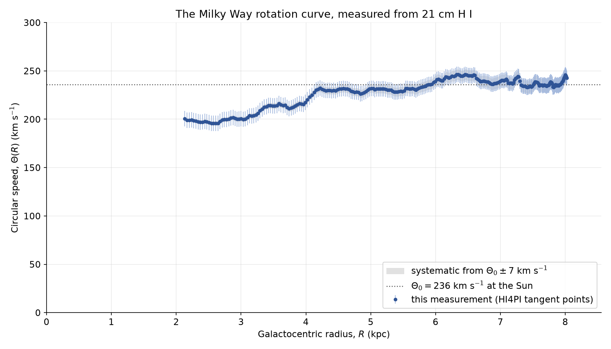

# Measuring the Milky Way's Rotation Curve from HI4PI 21 cm Data



End-to-end measurement of the Galactic rotation curve using the **tangent-point
method** on the **HI4PI 21 cm neutral-hydrogen survey** (HI4PI Collaboration,
Ben Bekhti et al. 2016, A&A 594, A116).

**Headline results**

| Quantity | Value |
|---|---|
| Sightlines measured | 780 (100% clean edges) |
| Longitude bins | 260 (l = 15°–80°, Quadrant I) |
| Radius range | R = 2.1 – 8.0 kpc |
| Circular speed | 196 – 246 km/s (median 234 km/s) |
| Enclosed mass at 8 kpc | 1.1 × 10¹¹ M☉ (~5.5× the Keplerian point-mass expectation) |
| Agreement with Eilers et al. (2019) | ~1–2% over 5–7.8 kpc |

## Method in one paragraph
Each sightline's H I spectrum yields a **terminal velocity** — the extreme-velocity
edge of the emission (a 10 K threshold crossed by ≥ 3 consecutive 1.29 km/s
channels, interpolated linearly). Tangent-point geometry converts this to
R = R₀ sin l and Θ(R) = |v_term| + Θ₀ sin l; speeds become enclosed masses via
M(<R) = Θ²R/G. An **edge-bias calibration** is anchored to the l ≥ 70° region
where geometry fixes the answer (median excess 13.6 km/s, corrected and
uncorrected curves both reported).

## Pipeline
- **Data:** five CAR_E cubes (CAR_E01–E05, 264 MB each) downloaded from the CDS
  archive and **SHA-256 verified** against published checksums (`run_record.json`).
- **Software:** Python — `astropy` (FITS I/O, WCS, spectral frames), `NumPy`,
  `pandas`, `Matplotlib`. All steps run end-to-end in one reproducible notebook.
- **Reproducibility:** deterministic edge criterion, recorded run parameters,
  checksummed input data.

## Repository layout
```
├── notebooks/MilkyWay_Rotation_Curve_ALGO.ipynb   # full analysis (executed)
├── figures/                                       # all result figures
├── data/                                          # processed CSV outputs
├── Project_Report.pdf                             # detailed write-up
└── run_record.json                                # data checksums + run log
```

## Key figures
| Figure | What it shows |
|---|---|
| `01_lv_diagram.png` | longitude–velocity diagram of the Quadrant I disk |
| `03_terminal_velocity_overlay.png` | QC: measured edges hugging the emission boundary |
| `07_measured_vs_keplerian.png` | flat measured curve vs. falling Keplerian curve |
| `11_before_and_after_correction.png` | edge-bias corrected vs. uncorrected curve |

## Skills demonstrated
FITS/spectral data handling · astropy pipelines · data-intensive batch analysis
(780 sightlines) · systematic-bias quantification · reproducible research practice.

---
*Author: Roshani Devendra Naik ([@roshninaik49649-blip](https://github.com/roshninaik49649-blip)) ·
Data: HI4PI survey, publicly available via CDS.*
